# 📝 รายงานผลการทดลองที่ 4: Flutter Layout & Navigation
**รหัสนักศึกษา:** 67030323
**ชื่อ-นามสกุล:** นาย พรพรม สุขใจมิตร

---

## 📸 ส่วนที่ 1: บันทึกผลการทดลอง (Checkpoints)

### 🎯 Checkpoint 3: การแก้ไข DestinationCard
* **คำอธิบาย:** แก้ไขตำแหน่ง Rating Badge, เพิ่มไอคอนพร้อมเข้าพัก และอธิบายการใช้ `Positioned` คู่กับ `Stack`
* **รูปผลการทดลอง / รูปโค้ด:**

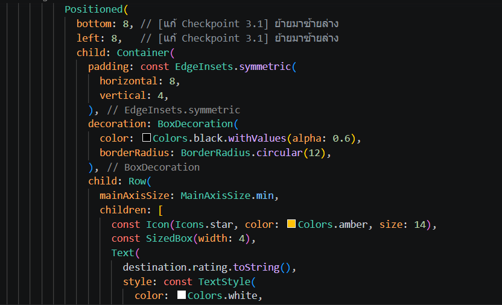
---
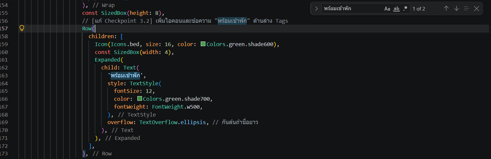
---
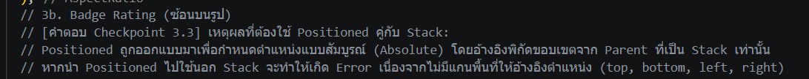
---
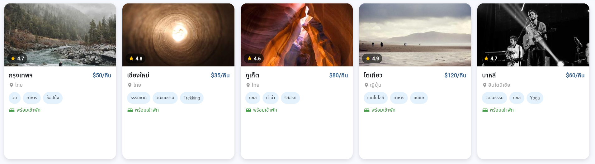
---

### 🎯 Checkpoint 4.1: Explore Screen (Responsive Grid)
* **คำอธิบาย:** เพิ่ม Breakpoint ระดับ Large (≥ 1200 dp) และเปรียบเทียบ `MediaQuery.of(context).size.width` กับ `constraints.maxWidth`
* **รูปผลการทดลอง / รูปโค้ด:**

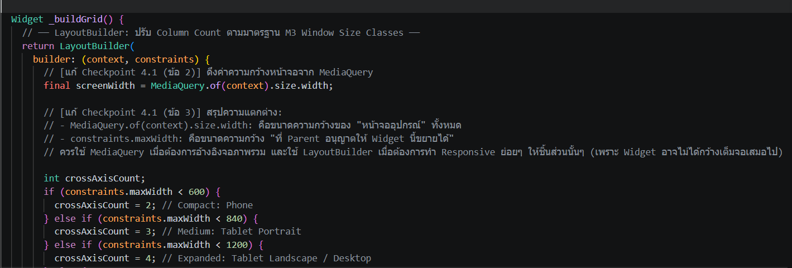
---
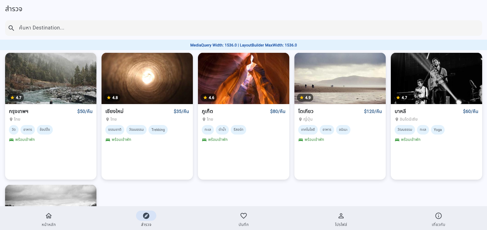


### 🎯 Checkpoint 4.3: Home Screen (ListView & Scroll)
* **คำอธิบาย:** แสดง Featured ทั้งหมดด้วย ListView แนวนอน, เพิ่ม "รีวิวยอดนิยม" แบบแนวตั้ง และอธิบายการใช้ `shrinkWrap`
* **รูปผลการทดลอง / รูปโค้ด:**

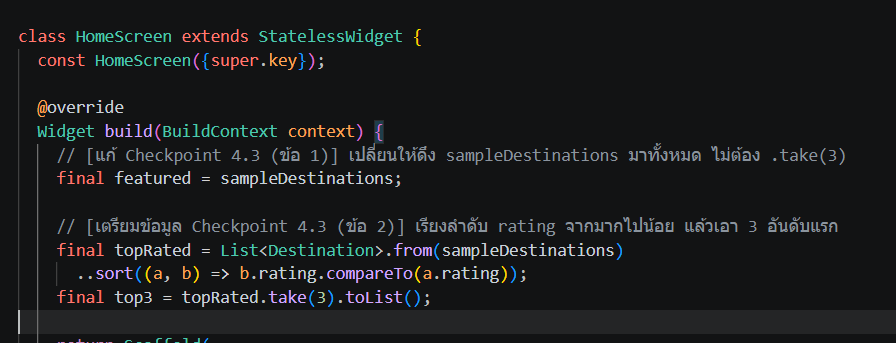
---
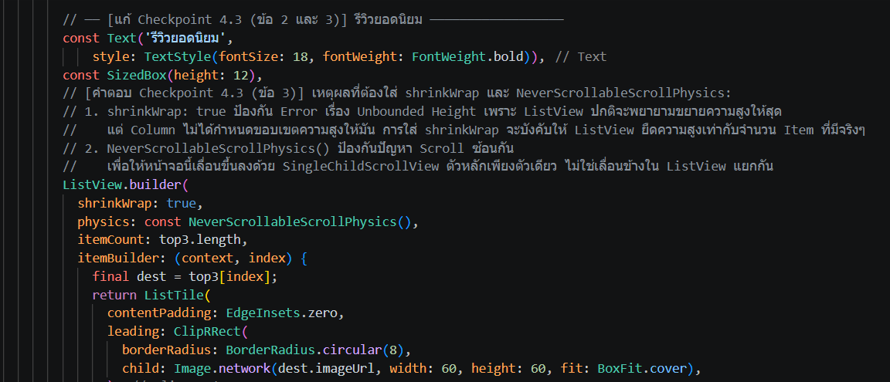
---
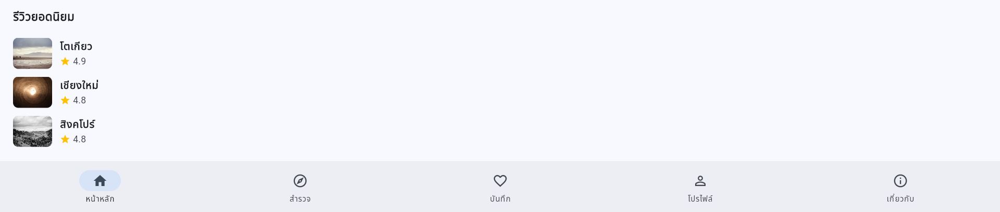
---


### 🎯 Checkpoint 5.1: Go Router & Fallback
* **คำอธิบาย:** เพิ่ม Branch "เกี่ยวกับ" และแก้ไข Fallback Logic เมื่อไม่พบข้อมูล ID
* **รูปผลการทดลอง / รูปโค้ด (หน้าไม่พบข้อมูล):**

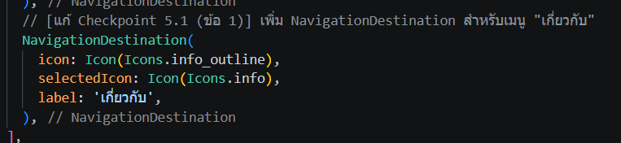
---
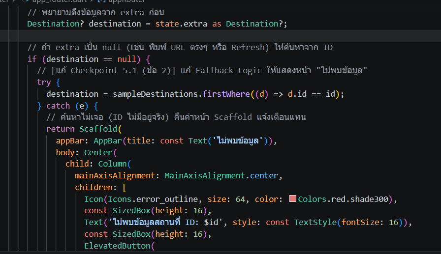
---
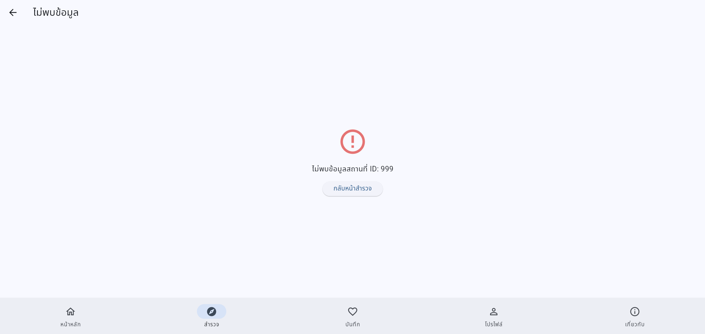


---

## 🧪 ส่วนที่ 2: ผลการทดสอบการทำงาน (จากการทดลองที่ 6.3)

| # | สิ่งที่ทดสอบ | ผลที่คาดหวัง | ผลจริง (✅/❌) |
|---|---|---|---|
| 1 | เปิดแอป | เห็น Home Screen + Bottom Navigation Bar | [✅] |
| 2 | กด Tab "สำรวจ" | เปลี่ยนไป Explore Screen แสดง Grid | [✅] |
| 3 | พิมพ์ค้นหา "โตเกียว" | ผลการค้นหาเหลือเฉพาะโตเกียว | [✅] |
| 4 | กดที่ Card ใด ๆ | เปิด Detail Screen พร้อมข้อมูลถูกต้อง | [✅] |
| 5 | กด Back บน Detail | กลับมา Explore Screen | [✅] |
| 6 | กด Tab "หน้าหลัก" | กลับหน้าหลัก โดยที่ Stack ใน Explore ยังไม่หาย | [✅] |
| 7 | กดหัวใจบน Detail | Snackbar แจ้งบันทึกสำเร็จ | [✅] |
| 8 | กด "จองเลย" บน Detail | Dialog แสดงการจองสำเร็จ | [✅] |
| 9 | กด "กลับหน้าหลัก" ใน Dialog | Navigate กลับ Home | [✅] |
| 10 | ปรับความกว้างหน้าจอ | Grid ปรับ Column Count ตาม M3 Breakpoint | [✅] |
| 11 | Refresh หน้า Detail บน Chrome | ข้อมูล Destination ยังแสดงถูกต้อง (Fallback ทำงาน) | [✅] |
| 12 | เลื่อนดู Featured List แนวนอน | เห็นครบทุก Destination เลื่อนซ้าย-ขวาได้ลื่นไหล | [✅] |
| 13 | พิมพ์ URL `/explore/destinations/999` | แสดงหน้า "ไม่พบข้อมูลที่ต้องการ" | [✅] |
| 14 | กด Tab "เกี่ยวกับ" | เปลี่ยนไปหน้า AboutScreen ได้ | [✅] |
| 15 | เทียบค่า MediaQuery กับ constraints | บันทึกค่าที่สังเกตได้และสรุปความแตกต่างในตาราง/คำตอบ | [✅] |

---

## 🏆 ส่วนที่ 3: โจทย์ท้าทาย (การทดลองที่ 8) - ทำ Saved Screen ให้ใช้งานได้จริง
* **คำอธิบายโค้ด 3 จุดที่ซับซ้อน:**
  1. ความซับซ้อนเกิดจากการที่ setState ปกติสามารถรีเฟรชได้แค่หน้าจอของตัวเองเท่านั้น แต่ฟีเจอร์นี้บังคับให้หน้า "สำรวจ", หน้า "รายละเอียด" และหน้า "บันทึกไว้" ต้องเห็นข้อมูลตรงกันทันที การสร้าง ValueNotifier<Set<String>> เป็นตัวแปร Global เพื่อเก็บ ID แบบ Set และการนำ ValueListenableBuilder ไปหุ้ม Widget ที่ต้องการให้เปลี่ยนค่า (Observer Pattern) จึงเป็นเรื่องที่ซับซ้อนที่สุดเพราะต้องเข้าใจวงจรการทำงานแบบ Reactive ของ Flutter
  2. โค้ดส่วนนี้ซับซ้อนเพราะเป็นการนำโครงสร้างหลายชั้นมาซ้อนกัน (Nesting) เริ่มจากต้องสร้างเงื่อนไขตรวจสอบ (Empty State) ถัดมาต้องกรองข้อมูล List หลัก (sampleDestinations) ให้เหลือเฉพาะ ID ที่ถูกบันทึกโดยใช้ Higher-order function .where() จากนั้นต้องส่งข้อมูลที่กรองแล้วเข้าไปคำนวณใน LayoutBuilder เพื่อหาจำนวนคอลัมน์ของตารางข้ามขนาดหน้าจออีกที ทำให้การจัดการวงเล็บและลำดับการ Build ค่อนข้างวุ่นวาย
  3. ปกติการ์ดนี้มี GestureDetector คลุมทั้งตัวเพื่อสั่งทำงานเปลี่ยนหน้าจอ (Navigation) อยู่แล้ว การเพิ่มปุ่มรูปหัวใจที่มีฟังก์ชัน toggleSaved() ทับลงไป ทำให้ต้องซ้อน GestureDetector อีกชั้นไว้ใน Positioned

* **รูปผลการทดลอง / รูปโค้ดหน้า Saved Screen:**

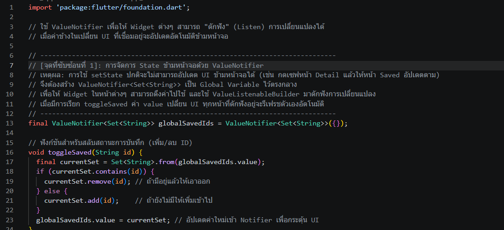
---
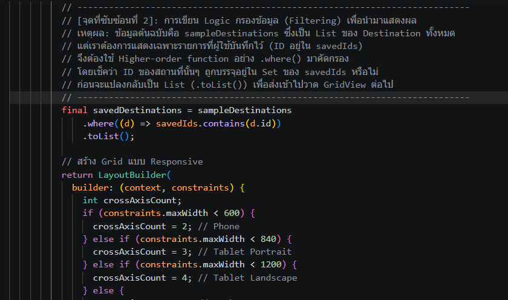
---
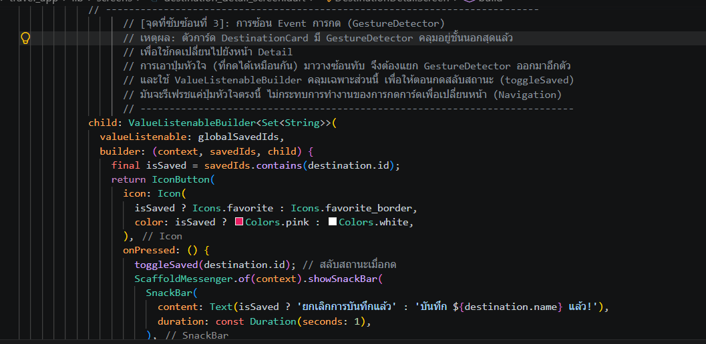
---
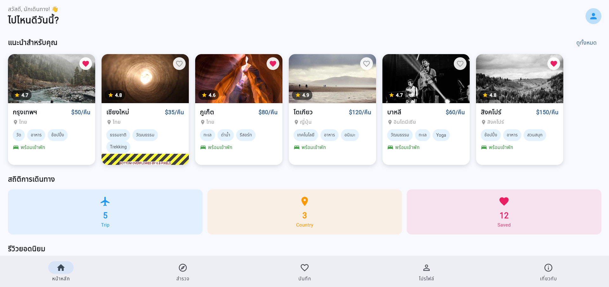
---
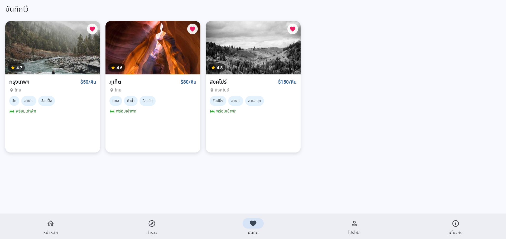
---

---
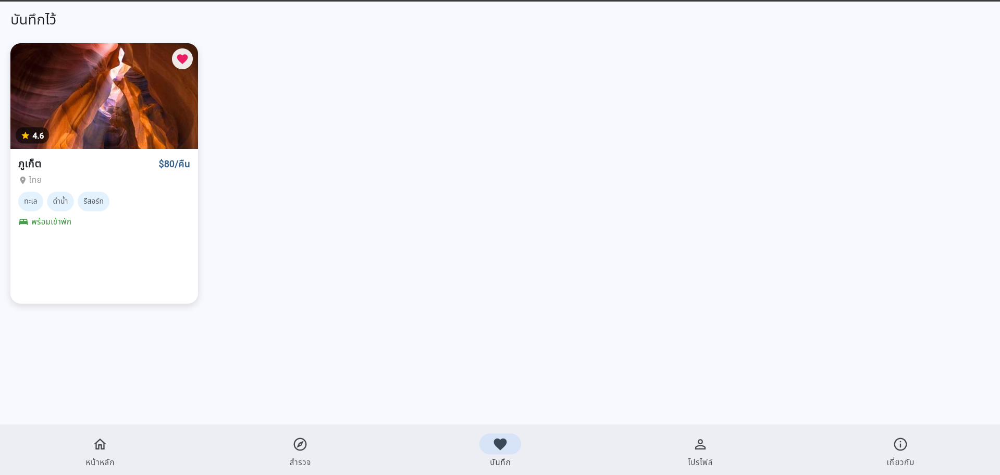


---

## 📝 ส่วนที่ 4: คำถามท้ายใบงาน

**1. `LayoutBuilder` ต่างกับ `MediaQuery` อย่างไร? มีหลักการเลือกใช้แต่ละแบบในสถานการณ์ใด?**
> **ตอบ :** LayoutBuilder จะดึงขนาดพื้นที่ "ที่ Parent อนุญาตให้ Widget นั้นขยายได้ (Constraints)" เหมาะสำหรับการทำ Responsive ในระดับ Component หรือชิ้นส่วนย่อยๆ เช่น การกำหนดจำนวนคอลัมน์ของ Grid ภายในการ์ดหรือพื้นที่จำกัดที่ไม่ใช่ขนาดเต็มจอ แต่ MediaQuery จะดึงขนาดความกว้าง/ความสูงของ "หน้าจออุปกรณ์ (Screen/Window)" ทั้งหมด เหมาะสำหรับการทำ Responsive ในระดับภาพรวมของแอป เช่น การตัดสินใจว่าจะใช้ Bottom Navigation Bar (สำหรับมือถือ) หรือ Navigation Drawer (สำหรับแท็บเล็ต/เดสก์ท็อป)

**2. ทำไม Go Router ถึงใช้ `StatefulShellRoute` แทน `ShellRoute` ธรรมดา? ผลต่างเรื่อง State Management คืออะไร?**
> **ตอบ :** เพราะ StatefulShellRouteจะรักษาสภาพ ของแต่ละ Tab เอาไว้ในหน่วยความจำ เมื่อสลับ Tab ไปมา State และตำแหน่ง Scroll จะยังคงอยู่เหมือนเดิม ทำให้ประสบการณ์ใช้งาน ไหลลื่นเหมือนแอปพลิเคชันทั่วไป แต่ ShellRoute ธรรมดา เมื่อผู้ใช้สลับ Tab ตัว Widget ของหน้าจอเก่าจะถูกทำลาย ทิ้งไป ทำให้ State หายทั้งหมด

**3. ในโค้ด `DestinationCard` เหตุใดจึงใช้ `Expanded` ครอบ `Text` ชื่อ Destination ? จะเกิดอะไรขึ้นถ้าลบออก?**
> **ตอบ :** ใช้ Expanded เพื่อบังคับให้ Text ชื่อสถานที่ยืดใช้พื้นที่ว่างที่เหลือใน Row ให้พอดี และผลักตัวเลขราคาไปชิดขวา หากลบ Expanded ออก แล้วชื่อสถานที่มีความยาวมากเกินไป จะทำให้เกิดข้อผิดพลาด RenderFlex overflow

**4. การส่งข้อมูลผ่าน `extra` ของ Go Router มีข้อจำกัดอะไรกรณี Deep Link / Web Refresh? และแก้ปัญหานี้ได้อย่างไร?**
> **ตอบ :** ข้อจำกัด extra เป็นการส่งข้อมูลออบเจกต์ผ่านหน่วยความจำภายในแอป หากผู้ใช้เปิดหน้านั้นผ่าน Deep Link หรือกด Refresh บนเบราว์เซอร์ ข้อมูลในหน่วยความจำจะหายไป ทำให้ค่า extra กลายเป็น null วิธีแก้ไขคือต้องใช้ระบบ Fallback โดยการส่งค่า Identifier ไปทาง pathParameters ด้วยเสมอ

**5. วาด Navigation Hierarchy ของแอปนี้ (สามารถวาดบนกระดาษแล้วถ่ายรูปส่งได้)**
> **ตอบ :** 
```
📱 Root Layout (ScaffoldWithNavBar)
 ├── Tab 0: /            (Home Screen)
 ├── Tab 1: /explore     (Explore Screen)
 │    └── /destinations/:id  (Destination Detail Screen)
 ├── Tab 2: /saved       (Saved Screen)
 ├── Tab 3: /profile     (Profile Screen)
 └── Tab 4: /about       (About Screen)
```
---